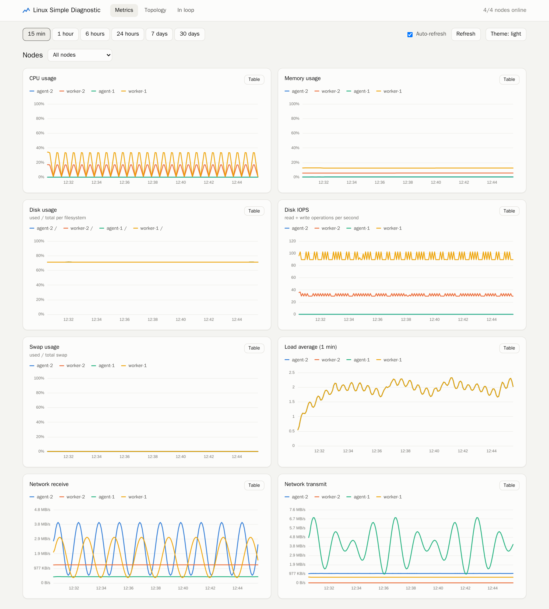
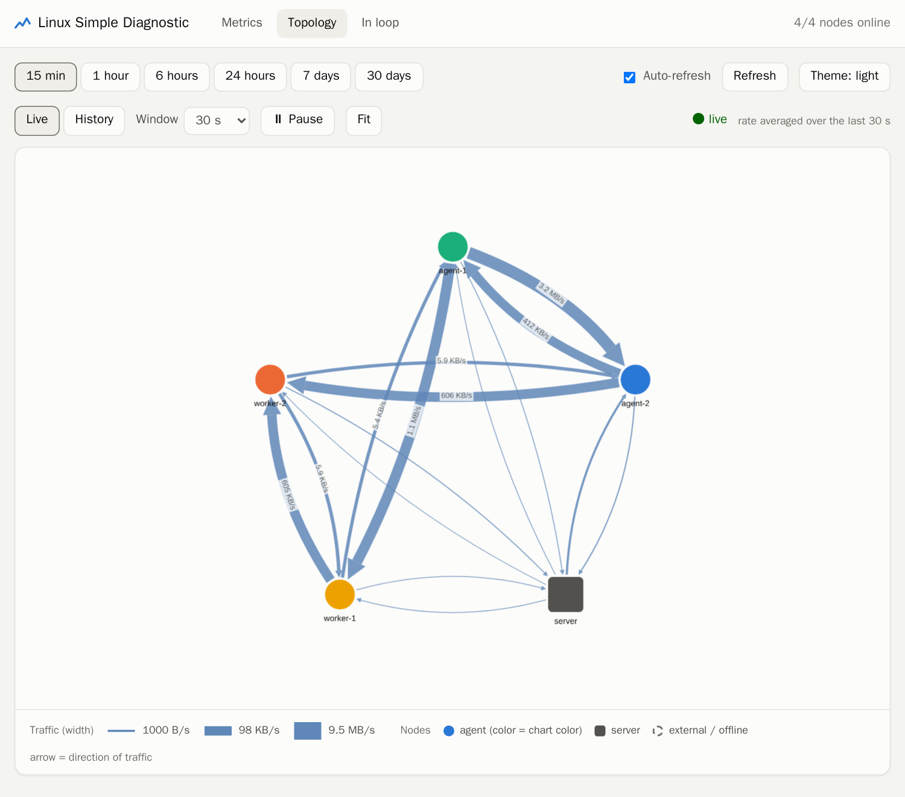

# Linux Simple Diagnostic (`lsd`)

**Linux Simple Diagnostic** gathers the basic metrics of a cluster of Linux machines and turns them into a clear, live web dashboard.

For every machine you see how busy it is (CPU, memory, swap, disk usage and IOPS, load average, network throughput), from the last few minutes up to 30 days, all machines side by side or one at a time. And you see how the machines talk to each other: a live map of the traffic between your hosts, with an arrow per direction that gets wider as the traffic grows.

It is deliberately small: one program, `lsd`, that you run as a light **agent** on every machine and as one **server** that stores the data and serves the dashboard. There is no database to run and no Prometheus or Grafana to wire up. It is a quick way to answer "what is going on across my machines right now?", not an alerting or log platform.

## What it looks like



*Metrics: the charts of all the machines side by side (or of a single machine, chosen in the drop-down), for any period from 15 minutes to 30 days.*



*Topology: the live traffic between hosts. An arrow shows the direction, its width follows the volume, and the colours match the charts. Both screenshots show a small demo cluster of four machines.*

## The pieces

* **Agents** collect CPU / memory / disk / network metrics and, with **eBPF**, host-to-host traffic volume. They push everything to the server over **gRPC**.
* The **server** stores metrics in an embedded **Prometheus TSDB** (pure Go, queryable with PromQL) and serves a **Vue 3** web UI: per-node and all-node charts for any period, and a **live topology** where edge direction is an arrow and edge width follows traffic volume.

```
agent (each Linux host)                        server
┌─────────────────────────────┐   gRPC     ┌──────────────────────────────────┐
│ host metrics (gopsutil/cgroup)│ client   │ ingest ─► Prometheus TSDB          │
│ eBPF TC flow accounting      ├─stream──► │        └► live topology window     │
│ ring buffer + auto-reconnect │ every 5 s │ REST + SSE + PromQL · embedded UI  │
└─────────────────────────────┘            └──────────────────────────────────┘
```

## Demo (Docker Compose: 1 server + 2 agents)

```bash
docker compose -f deploy/docker-compose.yml up -d --build
open http://localhost:8080
```

Two small traffic generators run inside the agents' network namespaces so the topology has something to show:
**agent-1 → agent-2** carries ~4 MB/s on a slow sine wave (thick edge), **agent-2 → agent-1** ~400 KB/s steady (thin edge), plus thin edges to/from the server.

Pages: **Metrics** (a *Nodes* dropdown switches between all nodes and a single node's detail), **Topology** (Live with a 10 s – 5 min window, or History over the selected range), **In loop** (a wall-display mode that rotates through connected agents, CPU, memory, disk usage, disk IOPS, swap, load average and the live topology, 5 seconds each; ← / → to switch, space to pause). Every chart has a *Table* view; the topology has a *Connections* table.

```bash
docker compose -f deploy/docker-compose.yml down        # stop (add -v to drop stored metrics)
```

The image builds natively on **amd64 and arm64** (including Apple Silicon Docker Desktop).
Containers share the Docker host's kernel, but each agent has its own network namespace and cgroup, so flows are captured per container and CPU/memory come from the container's own cgroup (`--metrics-scope cgroup`).
Note: the **load average** is always host-wide (the kernel has no per-cgroup load).

## Run without Docker (Linux)

```bash
make build                                   # builds the UI, then a static binary in bin/lsd

bin/lsd server --data-dir ./data   # UI+API on :8080, gRPC on :7070
sudo bin/lsd agent --server <server-host>:7070
```

The agent needs `CAP_BPF`, `CAP_NET_ADMIN` and `CAP_PERFMON` (or root) for flow capture. Without them it logs a warning and keeps sending host metrics. Use `--no-flows` to disable capture on purpose.
It works on macOS for metrics only (no eBPF), which is handy for development.

### Configuration

Every flag can also be set as `LSD_<NAME>` (e.g. `LSD_SERVER`, `LSD_INTERVAL`, `LSD_TOKEN`). `lsd <cmd> --help` lists them all.

| Agent | Default | |
|---|---|---|
| `--server` | `localhost:7070` | server gRPC address |
| `--node-id` / `--hostname` | persisted UUID / OS hostname | identity and display name |
| `--interval` | `5s` | collection interval |
| `--metrics-scope` | `host` | `cgroup` reports the container's own CPU/mem/IO/swap |
| `--flow-ifaces` | all physical | interface globs for flow capture (virtual `veth*`, `docker*`, `br-*`… are skipped) |
| `--token`, `--tls`, `--tls-skip-verify` | off | shared bearer token and TLS to the server |
| `--buffer` | `720` | batches kept while the server is unreachable (≈1 h at 5 s), replayed on reconnect |

| Server | Default | |
|---|---|---|
| `--grpc` / `--http` | `:7070` / `:8080` | listen addresses |
| `--data-dir` | `./data` | TSDB and node registry |
| `--retention` | `720h` | how long metrics are kept |
| `--token`, `--tls-cert`, `--tls-key` | off | require a token from agents; serve gRPC over TLS |
| `--external-top-n` | `50` | distinct external IPs kept per batch; the rest become “other external” |

**Security:** the gRPC port is plaintext without a token by default, and the HTTP UI/API has **no authentication**. Put it on a trusted network or behind a reverse proxy, and set `--token` (+ TLS) for agents.

## Install from Debian packages

`make deb` builds two packages in `dist/` (`DEB_ARCH=amd64` by default, or `arm64`; `VERSION=` sets the version):

```bash
make deb                    # dist/lsd-server_0.1.0_amd64.deb + dist/lsd-agent_0.1.0_amd64.deb
make deb DEB_ARCH=arm64
```

It works from macOS too (the binary is static; if `dpkg-deb` isn't installed it runs in a Debian container).

| | `lsd-server` | `lsd-agent` |
|---|---|---|
| Binary | `/opt/lsd/server/lsd` | `/opt/lsd/agent/lsd` |
| systemd unit | `lsd-server.service` | `lsd-agent.service` |
| Config (env file) | `/etc/lsd/server.env` | `/etc/lsd/agent.env` |
| State | `/var/lib/lsd-server` (metrics) | `/var/lib/lsd-agent` (node id) |
| Runs as | `lsd` user, no capabilities | `lsd` user + `CAP_BPF`, `CAP_NET_ADMIN`, `CAP_PERFMON`, `CAP_SYS_RESOURCE` |

```bash
sudo apt install ./lsd-server_0.1.0_amd64.deb          # UI on http://<host>:8080, gRPC on :7070
sudo apt install ./lsd-agent_0.1.0_amd64.deb
sudoedit /etc/lsd/agent.env                            # set LSD_SERVER=<server-host>:7070
sudo systemctl restart lsd-agent
journalctl -u lsd-agent -f
```

Both services are enabled and started on install. Every flag is a `LSD_*` variable in the env files (commented examples are included); edit and `systemctl restart`. The two packages use separate directories, so they can be installed on the same machine. The agent unit relies on `CAP_BPF`, so it needs Linux 5.8+ (tested on a 7.0 kernel only); on older kernels you'd have to adjust the capabilities with `systemctl edit lsd-agent`.

Removing a package stops and disables its service; the env file survives until `--purge`. Stored metrics (`/var/lib/lsd-server`), the node id and the `lsd` user are kept even on purge: delete them by hand if you want them gone.

### Releases (GitHub Actions)

[.github/workflows/packages.yml](.github/workflows/packages.yml) tests the code, builds the four packages (`lsd-server` and `lsd-agent`, each for `amd64` and `arm64`) and publishes them:

```bash
git tag v1.2.3 && git push origin v1.2.3
```

- **Pushing a tag** like `v1.2.3` or `v1.2.3-rc1` builds the packages with that version and creates a GitHub release holding the four `.deb` files and a `SHA256SUMS` file. A pre-release tag is published as a pre-release, and its Debian version is `1.2.3~rc1`, which sorts before `1.2.3`. Tags that don't look like `vX.Y.Z[-suffix]` are rejected.
- **Pull requests and manual runs** run the tests and build the packages, which stay available as workflow artifacts for 14 days; nothing is published.

Each architecture is checked before it is published (`.github/scripts/verify-debs.sh`: package names, control fields, installed files, maintainer scripts and, on amd64, the version the packaged binary reports). The ARM packages are cross-compiled, so no ARM runner is needed.

## Documentation

The installation and configuration guide is [docs/install.md](docs/install.md), also as a PDF ([docs/install.pdf](docs/install.pdf)). Both are built into the program, so a machine that only has the binary can get them:

```bash
lsd get-documentation --directory ./lsd-docs
```

This writes `install.pdf`, `install.md`, the systemd units (`systemd/`) and the example configuration files (`config/`), and refuses to overwrite existing files unless you add `--force`.

After editing `docs/install.md`, regenerate the PDF (it uses the Eisvogel template in `docs/templates/`). The PDF is committed and embedded into the binary, and a test checks that every `LSD_*` variable and flag the guide mentions exists in the code, and that every one the code has is documented.

```bash
make docs-docker     # in an Ubuntu 24.04 container (the reference environment, needs only Docker)
make docs            # with the pandoc and LaTeX installed on this machine
```

`make docs` was tested with pandoc 3.1.3 on Ubuntu 24.04 (inside the container above) and with pandoc 3.8 on macOS; it picks the right syntax-highlighting option for the installed pandoc version. On a plain Ubuntu 24.04 machine:

```bash
sudo apt install make pandoc texlive-latex-recommended texlive-latex-extra \
     texlive-fonts-recommended lmodern
```

The PDF is built with `pdflatex` and the standard Latin Modern fonts on purpose: no system fonts are involved, so the result does not depend on the machine, and the template's default font (Source Sans) would need `texlive-fonts-extra`, 1.7 GB installed on Ubuntu. The one constraint is that `docs/install.md` must stay plain ASCII (a test enforces it).

## How it works

**Flows.** A TC classifier (ingress + egress, attached with TCX on Linux ≥ 6.6, else `clsact` + `cls_bpf`) counts bytes/packets per `(src, dst, protocol, direction)` in an LRU hash map. It only reads UAPI `__sk_buff` fields, so no BTF/CO-RE is needed and one little-endian object runs on amd64 and arm64. Ports are intentionally not part of the key: ephemeral ports would explode cardinality. Byte counts come from `skb->len`, so GSO/GRO super-packets make *packet* counts approximate.

**Topology.** A packet A→B is seen as egress on A and ingress on B. The server keeps the sender's view when the sender is a flow-reporting node, and the receiver's ingress view only for external/non-reporting senders, so nothing is double counted. IPs map to nodes through each agent's registered addresses; the rest are external. Opposite directions are separate edges. Edge width is log-scaled from 1 px (≤ 1 KB/s) to 24 px (≥ ~100 MB/s); the legend shows the same scale.

**Storage.** Gauges are stored as-is (`lsd_cpu_percent`, `lsd_mem_bytes`, `lsd_disk_bytes`, `lsd_net_bps`, …). Flow volume is stored as monotonic counters `lsd_flow_bytes_total{src,dst,proto}`, so history is a PromQL `increase()`. Replayed agent batches are accepted up to 2 h in the past (TSDB out-of-order window). Charts auto-select a step (~360 points per series).

**API.**

| Endpoint | |
|---|---|
| `GET /api/nodes` | nodes, online state, latest values |
| `GET /api/metrics?metric=&node=all\|<id>&range=1h` | chart series (`cpu`, `cpu_modes`, `load`, `mem_pct`, `mem_bytes`, `swap_pct`, `disk_pct`, `disk_io`, `disk_iops`, `net_bps`, `net_pps`, `agents`) |
| `GET /api/topology?window=30s` or `?range=24h` | live or historical graph |
| `GET /api/live` | Server-Sent Events: topology + nodes every 2 s |
| `GET /api/v1/query_range`, `/api/v1/query` | Prometheus-compatible, so Grafana can use the server as a Prometheus data source |

## Development

```bash
make test        # Go unit tests (+ `cd web && npm test`)
make deb         # .deb packages for the server and the agent (see above)
make docs        # docs/install.md -> docs/install.pdf (pandoc + pdflatex; or make docs-docker)
make test-metrics  # checks the CPU / memory numbers against known loads, in a container
make test-bpf    # runs the real BPF program with BPF_PROG_TEST_RUN (privileged container)
make generate    # recompile bpf/flows.bpf.c (clang in a container); outputs are committed
make proto       # regenerate gRPC code (protoc + protoc-gen-go + protoc-gen-go-grpc)
cd web && npm run dev   # Vite dev server, proxies /api to localhost:8080
```

Layout: `cmd/lsd` (CLI) · `internal/agent` (collection, eBPF, sender) · `internal/server` (ingest, store, topology, api) · `internal/loadgen` (demo traffic) · `bpf/` (C source) · `proto/` · `web/` (Vue app, embedded into the binary) · `deploy/` (Dockerfile, compose) · `docs/` (installation guide, embedded) · `packaging/` (systemd units, env files and maintainer scripts for the `.deb`s).
